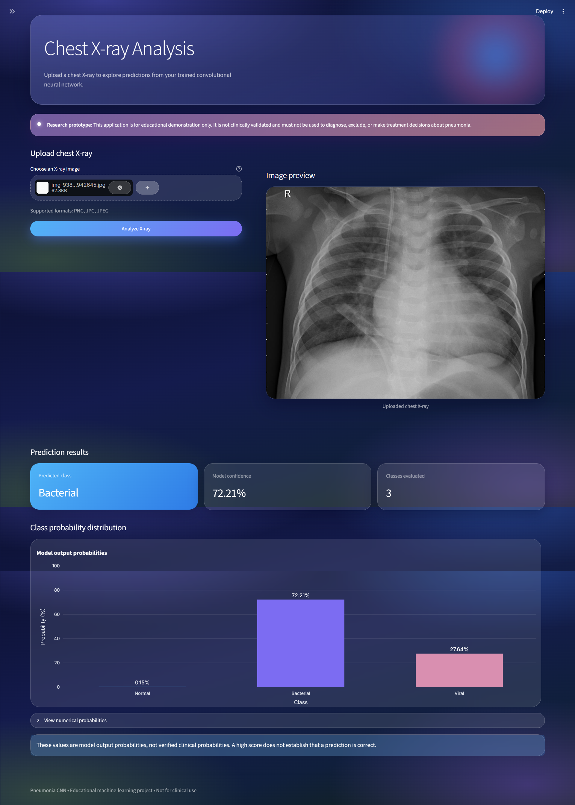
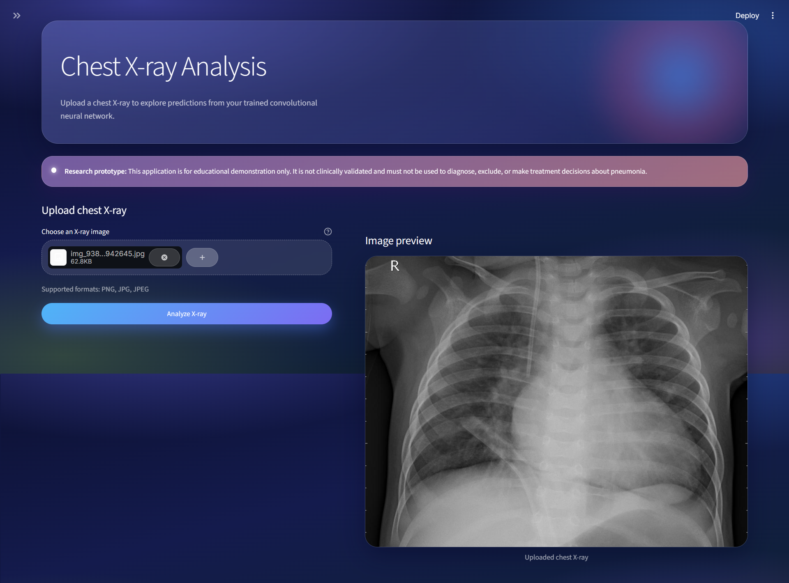
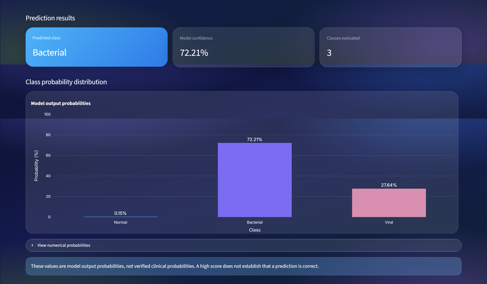

# 🫁 Pneumonia CNN Web App

A local **Streamlit** dashboard that uses a trained **TensorFlow/Keras CNN** to classify a chest X-ray into one of three classes: **Normal**, **Bacterial pneumonia** or **Viral pneumonia**.




> ⚠️ **Medical disclaimer:** This is an educational machine-learning project, **not** a clinically validated diagnostic tool. Do not use its predictions to diagnose, rule out disease, or make treatment decisions. The displayed scores are raw model output probabilities, not guaranteed clinical probabilities.

---

## Table of Contents

1. [Features](#features)
2. [Screenshots](#screenshots)
3. [Quick Start](#quick-start)
4. [Project Structure](#project-structure)
5. [Class Mapping](#class-mapping)
6. [How the App Works](#how-the-app-works)
7. [Dataset and Preparation](#dataset-and-preparation)
8. [Model and Training](#model-and-training)
9. [Evaluation Results](#evaluation-results)
10. [Troubleshooting](#troubleshooting)
11. [Limitations and Future Work](#limitations-and-future-work)

---

## Features

- Upload a chest X-ray (PNG, JPG or JPEG) and preview it.
- Automatic preprocessing to match the CNN's training input.
- Predicted class and top confidence score.
- Bar chart and numerical table of the scores for all three classes.
- Model cached with `st.cache_resource`, so it loads only once.
- Modern dark "glass" interface with a gradient background, frosted cards and pill buttons.
- Clear educational-use disclaimer shown in the app.

## Screenshots

### Upload and preview

Upload an X-ray, check the preview, then click **Analyze X-ray**.



### Prediction results

The result cards show the predicted class, the model confidence and the number of classes. Below them are the probability chart, an expandable table of exact scores and a reminder about how to read the numbers.



---

## Quick Start

These steps are for Windows with Anaconda Prompt. The model checkpoint must already be in `models/`.

```bash
# 1. Create and activate an environment
conda create -n pneumonia-web python=3.11 -y
conda activate pneumonia-web

# 2. Go to the project folder
cd %USERPROFILE%\Desktop\Pneumonia_CNN_WebApp

# 3. Install dependencies
python -m pip install --upgrade pip
pip install -r requirements.txt

# 4. Run the app
streamlit run app.py
```

Streamlit opens the app at <http://localhost:8501>. If it does not open automatically, visit that address yourself. Press `Ctrl+C` in the terminal to stop the server.

`requirements.txt`:

```text
tensorflow
streamlit
numpy
pillow
pandas
plotly
```

> 💡 For repeatable deployments, pin exact versions once you have confirmed a working environment.

## Project Structure

```text
Pneumonia_CNN_WebApp/
├── app.py                      # Streamlit UI, preprocessing, inference, chart
├── requirements.txt            # Python dependencies
├── README.md
├── .streamlit/
│   └── config.toml             # Dark theme settings
├── docs/
│   └── images/                 # README screenshots
└── models/
    └── best_pneumonia_cnn.keras  # Best checkpoint from Google Colab
```

The training notebook and the original dataset are kept separately from this web app.

## Class Mapping

| Class ID | Meaning              | Label shown in the app |
| :------: | -------------------- | ---------------------- |
|   `0`    | Normal               | Normal                 |
|   `1`    | Bacterial pneumonia  | Bacterial              |
|   `2`    | Viral pneumonia      | Viral                  |

Defined in `app.py`:

```python
CLASS_NAMES = {
    0: "Normal",
    1: "Bacterial",
    2: "Viral",
}
```

> The order of these IDs matters. Do not change it unless you have rechecked the label definitions of the training dataset.

---

## How the App Works

**1. Model loading.** The model is loaded from a path relative to `app.py` and cached across reruns:

```python
BASE_DIR = Path(__file__).resolve().parent
MODEL_PATH = BASE_DIR / "models" / "best_pneumonia_cnn.keras"
```

**2. Upload and preview.** Pillow opens the uploaded image and the dashboard shows a preview.

**3. Preprocessing.** The image is processed exactly like the training data:

1. Apply EXIF orientation correction.
2. Convert to grayscale (`L`).
3. Resize to `224 × 224`.
4. Convert to `float32` and divide by `255.0`.
5. Add batch and channel dimensions, giving shape `(1, 224, 224, 1)`.

> Do not feed the model images prepared differently from the training pipeline.

**4. Prediction.**

```python
probabilities = model.predict(input_array, verbose=0)[0]
predicted_class = int(np.argmax(probabilities))
confidence = float(probabilities[predicted_class]) * 100
```

The highest score decides the displayed class. All three scores appear in a Plotly bar chart and a table.

**5. Interface.** The dashboard has a sidebar with model information, a hero header, a disclaimer card, the upload control with image preview, result cards, the probability chart, an expandable score table and a footer.

---

## Dataset and Preparation

The model was developed in Google Colab using the Kaggle dataset *"Chest Xrays: bacterial / viral pneumonia / normal."*

| Item                | Value                                   |
| ------------------- | --------------------------------------- |
| Training images     | 4,672 (labels in `labels_train.csv`)    |
| Test images         | 1,168 (no labels available)             |
| Classes             | `0`, `1`, `2`                           |
| CSV columns         | `file_name`, `class_id`                 |
| Train/validation    | Stratified 80/20 split                  |
| Validation images   | 935                                     |

```python
train_test_split(
    df,
    test_size=0.20,
    random_state=42,
    stratify=df["class_id"]
)
```

**Training preprocessing:** decode as grayscale, resize to `224 × 224`, convert to `float32`, normalize to `[0, 1]`, batch (32 images) and prefetch. The prepared `train_ds` and `val_ds` datasets were saved to Google Drive to avoid repeating the slow image-loading step.

**Class imbalance:** the labels are imbalanced, so balanced class weights were computed with scikit-learn's `compute_class_weight(class_weight="balanced", ...)` and passed to `model.fit`.

## Model and Training

A custom sequential CNN:

1. Input `224 × 224 × 1`
2. Four blocks with **32, 64, 128 and 256** filters. Each block has a `3 × 3` convolution (same padding, no bias), batch normalization, ReLU and max pooling.
3. Global average pooling
4. Dense layer, 128 units, ReLU
5. Dropout `0.5`
6. Output layer, 3 units, softmax

| Setting         | Value                                              |
| --------------- | -------------------------------------------------- |
| Optimizer       | Adam, initial learning rate `0.001`                |
| Loss            | Sparse categorical cross-entropy                   |
| Metric          | Accuracy                                           |
| Batch size      | 32                                                 |
| Max epochs      | 20                                                 |
| Class weights   | Balanced, from the training labels                 |
| Callbacks       | `ModelCheckpoint` (best val. loss), `EarlyStopping` (patience 4, restore best weights), `ReduceLROnPlateau` |

**Model size:** 1,265,771 total parameters (421,603 trainable, 960 non-trainable). Output shape `(None, 3)`.

The best model was saved to `/content/drive/MyDrive/Pneumonia_CNN/results/best_pneumonia_cnn.keras`, downloaded from Colab, and placed in `models/`.

---

## Evaluation Results

The best checkpoint came from **epoch 10**: validation accuracy **78.29%**, validation loss about **0.5256**.

| Class                    | Precision | Recall | F1-score | Support |
| ------------------------ | --------: | -----: | -------: | ------: |
| 0 / Normal               |    0.9274 | 0.8821 |   0.9042 |     246 |
| 1 / Bacterial pneumonia  |    0.8049 | 0.8013 |   0.8031 |     448 |
| 2 / Viral pneumonia      |    0.6118 | 0.6473 |   0.6290 |     241 |
| **Accuracy**             |           |        | **0.7829** |   **935** |
| Macro average            |    0.7813 | 0.7769 |   0.7788 |     935 |
| Weighted average         |    0.7874 | 0.7829 |   0.7848 |     935 |

> Viral pneumonia is the weakest class (F1 = 0.6290). Keep this in mind when presenting the project.

### Validation checks performed

Validation accuracy and loss jumped sharply between some epochs during training, so these checks were run:

- The saved best checkpoint was reloaded and evaluated three times, with identical results (loss `0.5256`, accuracy `0.7829`).
- The validation set has 30 batches and 935 samples, with class counts `{0: 246, 1: 448, 2: 241}`.
- A SHA-256 hash of the validation tensors and labels was identical across two passes.
- A sample batch had shape `(32, 224, 224, 1)`, dtype `float32`, pixel range `0.0–1.0` and `int32` labels.

These checks show that the validation data and the final evaluation are stable. They did **not** explain the training-time fluctuations, which remain an open question.

No labeled test set was available, so **no test accuracy is reported**.

---

## Troubleshooting

| Problem | What to try |
| ------- | ----------- |
| **Model file not found** | Check that `models/best_pneumonia_cnn.keras` exists. Windows may have renamed it, for example to `best_pneumonia_cnn (1).keras`. |
| **TensorFlow import or install errors** | Activate the environment (`conda activate pneumonia-web`) and run `python -c "import tensorflow as tf; print(tf.__version__)"`. If installation fails, record the full error and Python version before changing package versions. |
| **`streamlit` command not found** | Run `python -m streamlit run app.py`. |
| **Wrong prediction labels** | Make sure `CLASS_NAMES` matches the class IDs used in training. |
| **Unexpected result for an image** | Confirm the image is a suitable chest X-ray and that preprocessing matches training. A wrong prediction can still come with a high score. |

---

## Limitations and Future Work

**Current limitations**

- Evaluated only on the validation split described above. No independent labeled test set.
- Viral pneumonia performance is noticeably weaker than the other classes.
- Training-time validation fluctuations are unexplained.
- Not clinically validated.
- Local prototype only: not deployed, with no authentication, database, prediction history or patient-data storage.

**Ideas for improvement**

1. Investigate the validation fluctuations before further tuning.
2. Evaluate on a properly labeled, independent test set.
3. Track model and dependency versions.
4. Improve error handling and upload validation.
5. Add automated tests for preprocessing and model output shape.
6. Deploy only after considering model size, resource limits, privacy and the medical disclaimer.
7. Avoid storing uploaded medical images unless there is a clear need and proper privacy protection.

## Project Status

The CNN is trained, the best checkpoint loads locally, and the Streamlit app runs with upload, preprocessing, prediction cards and the probability chart. The project is a **work in progress** until it has been tested end to end with representative images and the open evaluation questions are resolved.
